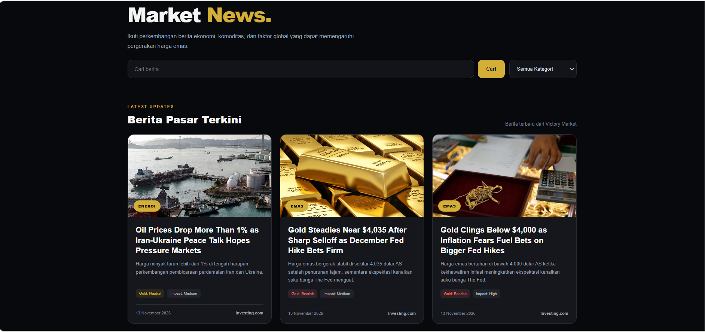
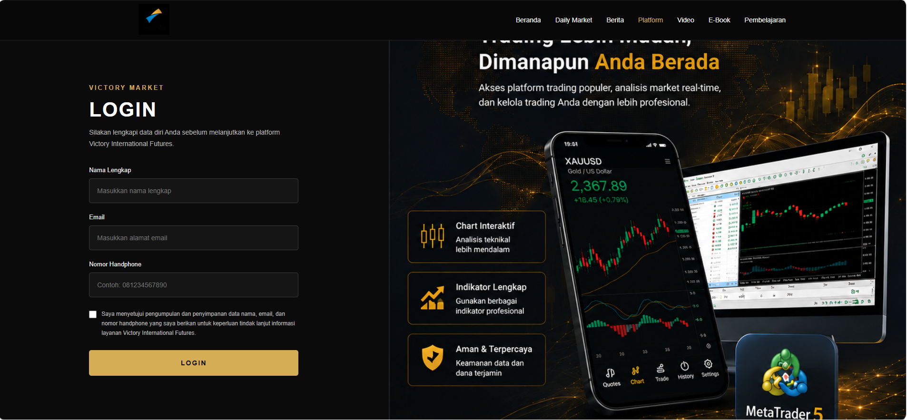
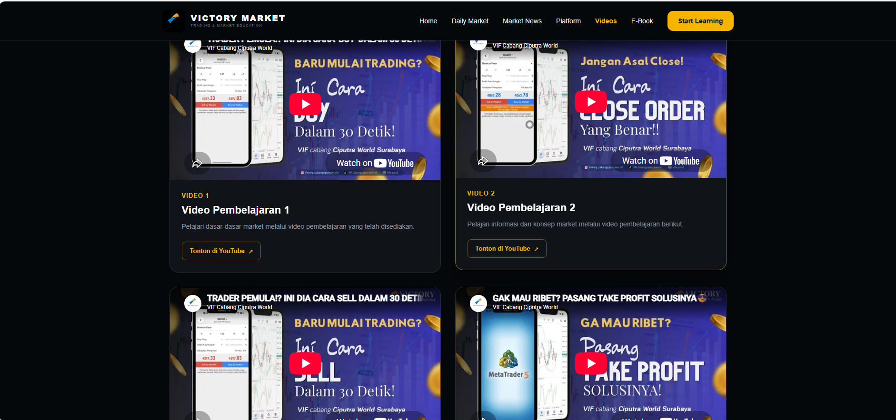
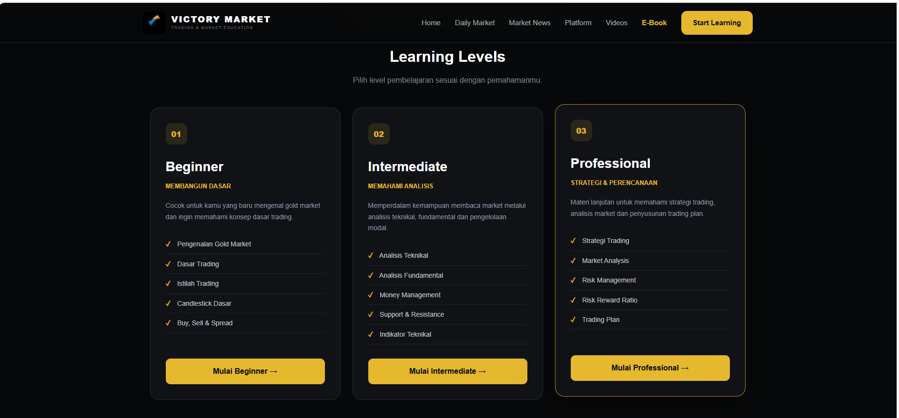

# VICTORY MARKET

Platform edukasi dan informasi pasar emas yang menyediakan informasi market, berita pasar, video tutorial, serta materi pembelajaran berdasarkan tingkat kemampuan pengguna.

## Tampilan Aplikasi

### 1. Homepage

### 2. Market News

### 3. Login / Registrasi

### 4. Video Tutorial

### 5. E-Book dan Learning Levels

## Fitur Utama

- **Homepage:** ringkasan platform edukasi pasar emas.
- **Daily Market:** informasi perkembangan pasar.
- **Market News:** berita ekonomi, komoditas, dan faktor global terkait pasar emas.
- **Platform:** informasi akses platform trading.
- **Video Tutorial:** materi pembelajaran dalam format video.
- **E-Book:** materi belajar dengan level Beginner, Intermediate, dan Professional.

## Teknologi

Sesuaikan daftar ini dengan teknologi yang benar-benar digunakan dalam project, misalnya PHP, MySQL, HTML, CSS, dan JavaScript.

## Menjalankan Project Secara Lokal

1. Letakkan folder project di direktori `htdocs` XAMPP.
2. Jalankan Apache dan MySQL melalui XAMPP.
3. Import file database yang diperlukan melalui phpMyAdmin.
4. Sesuaikan konfigurasi database lokal.
5. Buka `http://localhost/aurum/` di browser.

> Catatan: Jangan unggah password database, API key, token, atau data pribadi ke repository publik. Gunakan file konfigurasi contoh tanpa kredensial asli.
